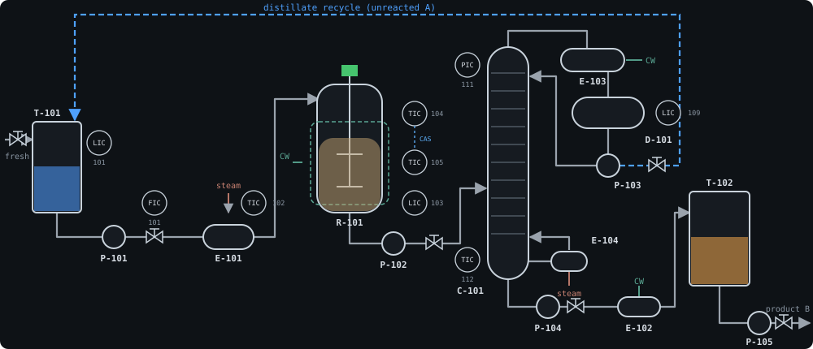

# CHEM-3D DCS

A web-based **3D distributed control system (DCS) and operator training simulator** for a chemical process unit. It pairs a first-principles dynamic plant model with the parts of a real control system: PID loops with cascade control, a safety instrumented system (SIS), ISA-18.2 alarm management, a historian, an audit trail and an instructor station. All of it runs behind a Three.js operator console that animates the plant live.

**▶ Live demo: https://vaithinathan571-del.github.io/chem-3d-dcs/**. Click **instructor** on the sign-in page. The simulation runs entirely in your browser, and each tab gets its own plant.



## Features

| Area | What you get |
| --- | --- |
| **Process model** | Feed tank, steam preheater, jacketed exothermic CSTR (Arrhenius kinetics, thermal runaway, relief valve), distillation column (bubble-point thermodynamics, reflux/boil-up separation model, pressure dynamics), reflux drum, product cooler and tank, distillate recycle. |
| **Field equipment** | Control valves with stroke time and flow characteristics, motors with start/stop ramps, permissives and trips, transmitters with lag, noise, low-flow cut-off and fault modes (fail low/high, frozen, drift). |
| **Control** | 11 PID loops and 1 manual loader. Velocity-form PID with MAN/AUTO/CAS modes, bumpless transfer, anti-windup, filtered derivative, SP tracking, cascade IMAN back-calculation and mode shedding on BAD PV. |
| **Safety (SIS)** | 7 latching safety functions plus a manual ESD pushbutton. Each reads an independent sensor, records first-out, resets only once the condition clears, and supports an audited engineer bypass. Tripped functions force valves and inhibit motor starts. |
| **Alarms** | ISA-18.2 state model (UNACK / ACKED / RTN-UNACK / SHELVED). Limit alarms have deadband and on-delay. Also deviation, BAD-PV, DCS-vs-SIS discrepancy, motor trip, PSV lift, overflow and alarm-flood detection. Alarms can be acknowledged and shelved, and an audible horn sounds. |
| **Historian & journal** | 1-second historian (4 h by default) with decimated queries. A sequence-of-events journal records every alarm, operator action, SIS action and instructor intervention, and exports to CSV. |
| **Instructor station** | Run/freeze, 0.5×–50× simulation speed, 15 malfunctions (utilities, equipment, process, instruments), and snapshots that can be saved, loaded and persisted. |
| **3D operator console** | Procedural 3D plant: live vessel levels coloured by composition, column tray temperature profile, rotating agitator and pumps, animated pipe flows, valve positions, hot-reactor glow and flashing alarm highlighting. Floating data cards, camera presets and click-to-faceplate navigation. |
| **2D displays** | Faceplates (loop, indicator, motor, equipment), overview group display with KPIs, alarm summary, multi-pen trends, event journal, SIS matrix, instructor panel. |
| **Security** | Role-based access (viewer / operator / engineer / instructor), scrypt-hashed passwords, HMAC-signed session tokens, CSP and security headers, request size limits. |

## Quick start

Requirements: **Node.js ≥ 20.19** (22 LTS recommended).

```bash
npm install
```

Development (server with auto-reload, plus the Vite dev server on http://localhost:5173). Use `npm run dev:standalone` instead to run without the server:

```bash
npm run dev
```

Production build, served by the DCS server on http://localhost:8080:

```bash
npm run build
```

```bash
DCS_SECRET=change-me npm start
```

Sign in by clicking a demo account on the login page, or type its name; the password is the same as the username.

| User | Role | Can |
| --- | --- | --- |
| `viewer` | viewer | Watch only |
| `operator` | operator | Change SP/OP/mode, start/stop motors, acknowledge and shelve alarms, reset interlocks, ESD |
| `engineer` | engineer | Operator rights, plus tuning, alarm limits and SIS bypass |
| `instructor` | instructor | Everything, plus simulation control, malfunctions and snapshots |

> Configure real accounts with `DCS_USERS` before exposing the server to anyone (see below).

### Live demo on GitHub Pages

The repository includes a **standalone build** for static hosting. In it, the complete DCS runtime (process model, control, SIS, alarms, historian) runs in a Web Worker inside the browser, so no server is needed. [.github/workflows/pages.yml](.github/workflows/pages.yml) tests, builds and publishes it on every push to `main`.

1. In the repository on GitHub, open **Settings → Pages → Build and deployment** and set **Source: GitHub Actions** (one-time).
2. Push to `main` (or run the workflow manually from the **Actions** tab).
3. The site is published at `https://<owner>.github.io/<repo>/`. This repository's demo is live at https://vaithinathan571-del.github.io/chem-3d-dcs/.

Build or preview it locally:

```bash
npm run build:pages
```

```bash
npm run preview:pages -w client
```

The output is in `client/dist-pages/` with relative asset paths, so it works under any sub-path. In the standalone demo, sign-in only selects a role, and each browser tab runs its own private simulation. Snapshots last until the tab is closed.

### Docker

```bash
DCS_SECRET=$(openssl rand -hex 32) docker compose up --build
```

## Configuration

Environment variables are read at start-up. With Node 22 you can keep them in a file and run `node --env-file=.env server/src/index.js`; see [.env.example](.env.example).

| Variable | Default | Purpose |
| --- | --- | --- |
| `PORT` / `HOST` | `8080` / `0.0.0.0` | HTTP listen address |
| `DCS_SECRET` | random per start | HMAC key for session tokens |
| `DCS_USERS` | demo accounts | JSON array of `{username, password, role, displayName?}` |
| `DATA_DIR` | `./data` | Snapshot persistence |
| `STATIC_DIR` | `client/dist` | Built operator client |
| `PRERUN_SECONDS` | `14400` | Simulated time used to settle the plant at start-up |
| `HISTORIAN_HOURS` | `4` | Historian retention |
| `BROADCAST_MS` | `500` | Live-data push period |
| `SIM_SEED` | fixed | Seed for reproducible measurement noise |

## Using the console

- **3D view.** Left-drag to orbit, right-drag to pan, scroll to zoom. Click equipment, a valve or a data-card row to open its faceplate. Double-click (or press `F`) to fly to the selection, and press `Esc` to deselect. Equipment with unacknowledged alarms flashes in the alarm's priority colour.
- **Faceplates.** Set the mode (MAN/AUTO/CAS), enter or nudge SP and OP, tune Kc/Ti/Td (engineer role) and edit alarm limits (engineer role). The 📈 button sends the loop to the trend display.
- **Alarm banner.** Shows the three most important alarms and the counts per priority. Use ACK / ACK ALL to acknowledge and the bell to mute the horn.
- **Training scenario.** As `instructor`, load the *Normal operation* snapshot and activate **MF-01 Cooling-water supply failure**. The column pressure trips IL-005 within minutes. The reactor then heats towards a runaway until IL-001 trips the feed, unless the operator cuts the feed rate first.

## Testing

```bash
npm test
```

This runs 39 unit and integration tests (PID, alarms, process model, SIS, historian, snapshots, REST/WebSocket API, auth).

```bash
npm run build
```

```bash
npm run test:e2e
```

The e2e smoke test drives a headless browser through the real UI. It needs Playwright: `npm i -D playwright && npx playwright install chromium`.

## API

REST endpoints need `Authorization: Bearer <token>`, except health and login.

| Method | Path | Description |
| --- | --- | --- |
| GET | `/api/health` | Liveness |
| POST | `/api/login` | `{username, password}` → `{token, user}` |
| GET | `/api/me` | Current user |
| GET | `/api/config` | Plant configuration (points, loops, interlocks, malfunctions, alarms…) |
| GET | `/api/state` | Live state snapshot |
| GET | `/api/history?series=TIC-104.PV,TIC-104.SP&from=&to=&points=` | Historian query (epoch ms) |
| GET | `/api/events?limit=&category=&tag=` | Event journal |
| GET | `/api/snapshots` | Saved snapshots |
| POST | `/api/commands` | `{action, params}`, the same commands as over WebSocket |

WebSocket `/ws?token=…`. The server sends `hello` (config, state and recent events), then `state` every 500 ms with any new events. It also sends `result`, `snapshots` and `alarmConfig` messages. Clients send `{type: "command", id, action, params}`.

Commands: `setSP`, `setOP`, `setMode`, `setTuning`, `motorStart`, `motorStop`, `ackAlarm`, `ackAll`, `shelveAlarm`, `unshelveAlarm`, `setAlarmLimit`, `enableAlarm`, `ilReset`, `ilBypass`, `esd`, `simRun`, `simFreeze`, `simSpeed`, `malfunction`, `snapshotSave`, `snapshotLoad`, `snapshotDelete`.

```bash
TOKEN=$(curl -s localhost:8080/api/login -d '{"username":"operator","password":"operator"}' | jq -r .token)
```

```bash
curl -s localhost:8080/api/commands -H "Authorization: Bearer $TOKEN" -d '{"action":"setSP","params":{"tag":"TIC-104","value":87}}'
```

## Project layout

```
server/                 Node.js DCS server (no build step, ESM)
  src/plant/            thermodynamics, process model, field equipment, plant configuration (tag database)
  src/control/          PID function block and control executive
  src/safety/           safety instrumented system
  src/alarms/           alarm manager (ISA-18.2)
  src/historian/        ring-buffer historian
  src/events/           sequence-of-events journal
  src/instructor/       malfunctions and snapshots
  src/auth/             users, roles, tokens
  src/api/              HTTP, static files, WebSocket
  src/runtime.js        real-time executive tying it all together
  test/                 node:test suites
client/                 Vite + Three.js operator console (vanilla JS)
  src/scene/            3D plant layout, procedural equipment models, scene controller
  src/ui/               faceplates, alarms, trends, events, SIS, instructor panels
  src/net/              REST/WebSocket client and the standalone (Web Worker) client
  src/local/            Web Worker hosting the DCS runtime for the standalone build
scripts/                dev runner, e2e smoke test
docs/                   architecture notes and process diagram
```

See [docs/ARCHITECTURE.md](docs/ARCHITECTURE.md) for the process design, the control strategy and the data flow.
